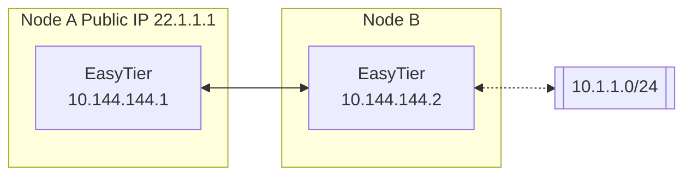
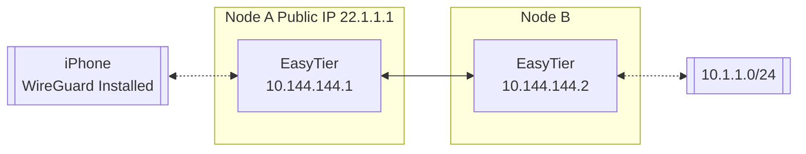

# EasyTier · Downstream adaptation

<p align="center"></p>

Downstream project status:

[](https://github.com/alniyata-firefly/easytier/releases)
[](https://github.com/EasyTier/EasyTier/blob/main/LICENSE)
[](https://github.com/alniyata-firefly/easytier/commits/main)
[](https://github.com/alniyata-firefly/easytier/issues)
[](https://github.com/alniyata-firefly/easytier/actions/workflows/build-linux.yml)
[](https://github.com/alniyata-firefly/easytier/actions/workflows/build-gui.yml)
[](https://github.com/alniyata-firefly/easytier/actions/workflows/checks.yml)

[简体中文](README.md) | [English](README_EN.md)

## Project provenance and downstream changes

This repository is an independently maintained **downstream adaptation of [EasyTier](https://github.com/EasyTier/EasyTier)**. The original VPN core, protocols, Tauri application foundation, and upstream documentation were created by the EasyTier project and its contributors. The upstream baseline recorded in this repository is [`8b7f1f0196edb5b580829ed5f135050fb5853478`](https://github.com/EasyTier/EasyTier/commit/8b7f1f0196edb5b580829ed5f135050fb5853478), dated October 5, 2026, with package version `2.7.0`. The `2.7.2` version used here identifies this downstream release; it does not imply an official upstream release or endorsement.

The downstream work adds and adapts:

- Central network administration, device enrollment with management tokens, network membership, and configuration delivery with node confirmation.
- A React Web console and React-based Windows and Android interfaces, retaining the EasyTier Core and Tauri integration.
- Multi-instance configuration, server and node resource observations, optional metrics history, IPv6 preference with IPv4 fallback, and automatic or manually selected uplink interfaces on supported platforms.
- A shared, independently drawn [blue three-node SVG identity](assets/brand/easytier.svg) for the console and client packages.
- Network-level compression, KCP/QUIC, encryption, protocol and DNS suffix policies delivered to managed members and the embedded Gateway. Policies override explicit member values; omitted fields preserve existing settings. Runtime changes can recreate network instances and briefly reconnect them.
- Management configuration support for custom STUN servers, relay limits and policies, virtual IPv6, complete SOCKS5 bind URLs, port whitelists, instance names and Linux namespaces. See [configuration and delivery semantics](docs/central-network-connectivity.md).
- Android/iOS hide unsupported uplink selection and interface binding controls and clear those options when importing or saving local configurations; desktop clients retain them.

This downstream adaptation uses and modifies EasyTier code and continues under **LGPL-3.0 (GNU Lesser General Public License, version 3)**. The original [LICENSE](LICENSE), copyright notices and contributor acknowledgments are retained. The downstream changes are described above, with their source available in this repository. Bundled HarmonyOS Sans SC and Inter keep their own licenses: the [HarmonyOS Sans Fonts License Agreement](easytier-web/frontend/public/fonts/LICENSE-HarmonyOS-Sans.txt) and [SIL Open Font License 1.1](easytier-web/frontend/public/fonts/LICENSE-Inter-GoogleFonts.txt). Font origins and original, unmodified web subsets are recorded in [font provenance](easytier-web/frontend/public/fonts/provenance.json) and the [font notices](easytier-web/frontend/public/fonts/font-notices.html).

The detailed feature descriptions, documentation links, installation script examples, and contributor acknowledgments below are retained from upstream. The installation scripts refer to the original EasyTier distribution. Use [this repository’s Releases](https://github.com/alniyata-firefly/easytier/releases) for downstream binaries and the matching source revision; see [GitHub Actions builds](docs/github-actions.md) for the build and packaging workflow.

> ✨ A simple, secure, decentralized virtual private network solution powered by Rust and Tokio

## Interface previews

These screenshots render this adaptation’s actual React interfaces with anonymous example data. Names, addresses, device identifiers, and metrics are illustrative. The desktop image previews the GUI in a browser with a simulated Core; it is not a native-device connectivity test.

| Console overview | Managed network members |
| --- | --- |
|  |  |
| Network transport settings | Desktop client preview |
|  |  |

[Downloads](https://github.com/alniyata-firefly/easytier/releases) · [Build and packaging documentation](docs/github-actions.md)

📚 **[Full Documentation](https://easytier.cn/en/)** | 🖥️ **[Web Console](https://easytier.cn/web)** | 📝 **[Download Releases](https://github.com/alniyata-firefly/easytier/releases)** | 🧩 **[Third Party Tools](https://easytier.cn/en/guide/installation_gui.html#third-party-graphical-interfaces)**

## Features

### Core Features

- 🔒 **Decentralized**: Nodes are equal and independent, no centralized services required
- 🚀 **Easy to Use**: Multiple operation methods via web, client, and command line
- 🌍 **Cross-Platform**: Supports Win/MacOS/Linux/FreeBSD/Android and X86/ARM/MIPS architectures
- 🔐 **Secure**: AES-GCM or WireGuard encryption, prevents man-in-the-middle attacks

### Advanced Capabilities

- 🔌 **Efficient NAT Traversal**: Supports UDP and IPv6 traversal, works with NAT4-NAT4 networks
- 🌐 **Subnet Proxy**: Nodes can share subnets for other nodes to access
- 🔄 **Intelligent Routing**: Latency priority and automatic route selection for best network experience
- ⚡ **High Performance**: Zero-copy throughout the entire link, supports TCP/UDP/WSS/WG protocols

### Network Optimization

- 📊 **UDP Loss Resistance**: KCP/QUIC proxy optimizes latency and bandwidth in high packet loss environments
- 🔧 **Web Management**: Easy configuration and monitoring through web interface
- 🛠️ **Zero Config**: Simple deployment with statically linked executables

## Quick Start

### 📥 Installation

Choose the installation method that best suits your needs:

Linux (Recommended):
```bash
curl -fsSL "https://github.com/EasyTier/EasyTier/blob/main/script/install.sh?raw=true" | sudo bash -s install
```

Homebrew (MacOS/Linux):
```bash
brew tap brewforge/chinese
brew install --cask easytier-gui
```

Windows (Recommended, run with administrator privileges):
```powershell
irm "https://github.com/EasyTier/EasyTier/blob/main/script/install.ps1?raw=true" | iex
```

Install via cargo (Latest development version):
```bash
cargo install --git https://github.com/EasyTier/EasyTier.git easytier
```

[Install pre-built binary](https://github.com/alniyata-firefly/easytier/releases) (Recommended, All platforms supported)

[Install via Docker](https://easytier.cn/en/guide/installation.html#installation-methods)

[Install OpenWrt ipk package](https://github.com/EasyTier/luci-app-easytier)

Additional steps:

[One-Click Register Service](https://easytier.cn/en/guide/network/oneclick-install-as-service.html) (Automatically start when the system boots and run in the background)

### 🚀 Basic Usage

#### Quick Networking with Shared Nodes

EasyTier supports quick networking using shared public nodes. When you don't have a public IP, you can use the free shared nodes provided by the EasyTier community. Nodes will automatically attempt NAT traversal and establish P2P connections. When P2P fails, data will be relayed through shared nodes.

When using shared nodes, each node entering the network needs to provide the same `--network-name` and `--network-secret` parameters as the unique identifier of the network.

Taking two nodes as an example (Please use more complex network name to avoid conflicts):

1. Run on Node A:

```bash
# Run with administrator privileges
sudo easytier-core -d --network-name abc --network-secret abc -p tcp://<SharedNodeIP>:11010
```

2. Run on Node B:

```bash
# Run with administrator privileges
sudo easytier-core -d --network-name abc --network-secret abc -p tcp://<SharedNodeIP>:11010
```

After successful execution, you can check the network status using `easytier-cli`:

```text
| ipv4         | hostname       | cost  | lat_ms | loss_rate | rx_bytes | tx_bytes | tunnel_proto | nat_type | id         | version         |
| ------------ | -------------- | ----- | ------ | --------- | -------- | -------- | ------------ | -------- | ---------- | --------------- |
| 10.126.126.1 | abc-1          | Local | *      | *         | *        | *        | udp          | FullCone | 439804259  | 2.6.2-70e69a38~ |
| 10.126.126.2 | abc-2          | p2p   | 3.452  | 0         | 17.33 kB | 20.42 kB | udp          | FullCone | 390879727  | 2.6.2-70e69a38~ |
|              | PublicServer_a | p2p   | 27.796 | 0.000     | 50.01 kB | 67.46 kB | tcp          | Unknown  | 3771642457 | 2.6.2-70e69a38~ |
```

You can test connectivity between nodes:

```bash
# Test connectivity
ping 10.126.126.1
ping 10.126.126.2
```

Note: If you cannot ping through, it may be that the firewall is blocking incoming traffic. Please turn off the firewall or add allow rules.

To improve availability, you can connect to multiple shared nodes simultaneously:

```bash
# Connect to multiple shared nodes
sudo easytier-core -d --network-name abc --network-secret abc -p tcp://<SharedNodeIP1>:11010 -p udp://<SharedNodeIP2>:11010
```

Once your network is set up successfully, you can easily configure it to start automatically on system boot. Refer to the [One-Click Register Service guide](https://easytier.cn/en/guide/network/oneclick-install-as-service.html) for step-by-step instructions on registering EasyTier as a system service.

#### Decentralized Networking

EasyTier is fundamentally decentralized, with no distinction between server and client. As long as one device can communicate with any node in the virtual network, it can join the virtual network. Here's how to set up a decentralized network:

1. Start First Node (Node A):

```bash
# Start the first node
sudo easytier-core -i 10.144.144.1
```

After startup, this node will listen on the following ports by default:
- TCP: 11010
- UDP: 11010
- WebSocket: 11011
- WebSocket SSL: 11012
- WireGuard: 11013

2. Connect Second Node (Node B):

```bash
# Connect to the first node using its public IP
sudo easytier-core -i 10.144.144.2 -p udp://FIRST_NODE_PUBLIC_IP:11010
```

3. Verify Connection:

```bash
# Test connectivity
ping 10.144.144.2

# View connected peers
easytier-cli peer

# View routing information
easytier-cli route

# View local node information
easytier-cli node
```

For more nodes to join the network, they can connect to any existing node in the network using the `-p` parameter:

```bash
# Connect to any existing node using its public IP
sudo easytier-core -i 10.144.144.3 -p udp://ANY_EXISTING_NODE_PUBLIC_IP:11010
```

### 🔍 Advanced Features

#### Subnet Proxy

Assuming the network topology is as follows, Node B wants to share its accessible subnet 10.1.1.0/24 with other nodes:



To share a subnet, add the `-n` parameter when starting EasyTier:

```bash
# Share subnet 10.1.1.0/24 with other nodes
sudo easytier-core -i 10.144.144.2 -n 10.1.1.0/24
```

Subnet proxy information will automatically sync to each node in the virtual network, and each node will automatically configure the corresponding route. You can verify the subnet proxy setup:

1. Check if the routing information has been synchronized (the proxy_cidrs column shows the proxied subnets):

```bash
# View routing information
easytier-cli route
```


2. Test if you can access nodes in the proxied subnet:

```bash
# Test connectivity to proxied subnet
ping 10.1.1.2
```

#### WireGuard Integration

EasyTier can act as a WireGuard server, allowing any device with a WireGuard client (including iOS and Android) to access the EasyTier network. Here's an example setup:



1. Start EasyTier with WireGuard portal enabled:

```bash
# Register one WireGuard client as virtual peer 10.144.144.3
sudo easytier-core -i 10.144.144.1 \
  --network-secret portal-secret \
  --vpn-portal wg://0.0.0.0:11013 \
  --vpn-portal-private-key "$(wg genkey)" \
  --vpn-portal-client phone=10.144.144.3
```

2. Get WireGuard client configuration:

```bash
# Get WireGuard client configuration
easytier-cli vpn-portal
```

3. In the output configuration, replace a wildcard `Peer.Endpoint` with the
   public IP/domain of your EasyTier node, then import it. `Interface.Address`
   is local to that WireGuard client and may be changed to any IPv4 address;
   EasyTier translates it to the registered virtual-peer address.

#### Self-Hosted Public Shared Node

You can run your own public shared node to help other nodes discover each other. A public shared node is just a regular EasyTier network (with same network name and secret) that other networks can connect to.

To run a public shared node:

```bash
# No need to specify IPv4 address for public shared nodes
sudo easytier-core --network-name mysharednode --network-secret mysharednode
```

## Related Projects

- [ZeroTier](https://www.zerotier.com/): A global virtual network for connecting devices.
- [TailScale](https://tailscale.com/): A VPN solution aimed at simplifying network configuration.

## License

The upstream EasyTier project and this downstream adaptation use the [GNU LGPL version 3 (LGPL-3.0)](LICENSE). The upstream source is [EasyTier/EasyTier](https://github.com/EasyTier/EasyTier); this repository preserves its history and notices alongside the downstream changes.

## Responsible Use

Use EasyTier only for lawful purposes and in compliance with applicable laws
and regulations. You are responsible for ensuring that you are authorized to
connect to and administer the networks and devices involved.
